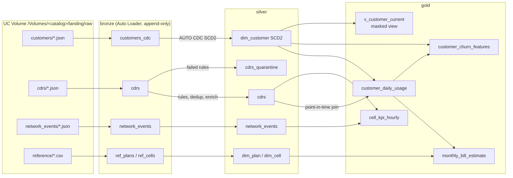

# Telco Lakehouse on Databricks

A lakehouse for a simulated German mobile operator, built the way a client
project would be: source feeds with real-world defects, a medallion pipeline on
Lakeflow Declarative Pipelines, an SCD Type 2 customer dimension, governed and
PII-masked consumption views, a data quality gate, and deployment through
Databricks Asset Bundles with CI.

Runs on **Databricks Free Edition** (serverless only).

## The business problem

The operator receives three nightly feeds and wants four answers from them.

| Source (simulated) | Format | What goes wrong in it |
|---|---|---|
| CRM customer master (CDC) | JSON lines, INSERT/UPDATE/DELETE | events arrive out of order, GDPR hard deletes |
| Mediation CDRs (voice, SMS, data) | JSON lines | duplicates from re-delivery, MSISDNs in 4 formats, negative durations, unknown cell IDs, late and future-dated records |
| OSS network KPIs and alarms | JSON lines, 15-min samples | impossible sensor values (PRB > 100%) |
| Reference: tariff plans, radio cells | CSV | none, but they change rarely and must be versioned with the code |

| Consumer | Gold table | Question |
|---|---|---|
| Network operations | `gold.cell_kpi_hourly` | Which cells drop calls, and is it load or a fault? |
| Finance / revenue assurance | `gold.monthly_bill_estimate` | What will we bill this month, including overage, given mid-month plan changes? |
| Marketing / data science | `gold.customer_churn_features` | Do customers on bad cells churn more? |
| Analysts | `gold.customer_daily_usage`, `gold.v_customer_current` | Usage by customer and plan, without exposing PII |

The generator hides a cause and effect in the data: some cells are degraded,
customers who suffer dropped calls are more likely to churn. If the pipeline is
correct, the churn query in `src/analytics/dashboard_queries.sql` finds it.

## Architecture



Orchestration (`resources/jobs.yml`, job `telco_daily`):

```
land_source_files ─▶ run_pipeline ─┬─▶ apply_governance
                                   └─▶ data_quality_gate ─▶ (fail = email alert)
```

## Design decisions worth explaining in an interview

1. **Quality rules are defined once** (`src/telco/transforms.py`) and used for both
   `expect_all_or_drop` and the quarantine table, so what is dropped and what is
   quarantined cannot drift apart.
2. **Rules run before the watermark.** A single CDR dated next year would otherwise
   push the dedup watermark forward and every normal record after it would be
   discarded as late. The local smoke test is what surfaced this.
3. **SCD2 is sequenced by CRM event time**, not file arrival, because the CDC feed
   arrives shuffled. `__START_AT/__END_AT` are timestamps, which lets gold do a
   point-in-time join: a call is billed against the plan valid *when it was made*.
4. **Late CDRs before the first CRM load** still resolve: the first SCD2 version is
   opened back to 1900 in the gold lookup.
5. **Two layers of data quality.** Expectations judge rows. The DQ gate
   (`src/jobs/dq_checks.py`) judges tables: reconciliation bronze vs silver,
   one open SCD2 row per key, unresolved MSISDN rate, freshness, billing sanity.
   Results land in `ops.dq_results` so the trend is queryable.
6. **PII never leaves silver unmasked.** Analysts get `gold.v_customer_current`
   where MSISDN/e-mail are masked and date of birth becomes an age band, unless the
   reader is in `telco_pii_readers` (`is_account_group_member`).
7. **Business logic is plain PySpark** with no `dlt` import, so it is unit tested
   locally and in CI. `tools/local_pipeline_run.py` runs the whole pipeline in batch
   mode on a laptop with a stand-in for the `dlt` module.
8. **Simulated time tracks real time.** The first run starts 30 days back; a
   30-batch backfill catches up with today, after which the daily schedule produces
   one day per run. The generator refuses to produce future days.

## Repository layout

```
databricks.yml               bundle: variables, dev/prod targets
resources/pipeline.yml       serverless Lakeflow pipeline
resources/jobs.yml           telco_setup (once) and telco_daily (scheduled)
src/telco/generator.py       synthetic source systems
src/telco/transforms.py      rules, cleansing, usage, billing (unit tested)
src/pipelines/               bronze.py, silver.py, gold.py
src/jobs/                    generate_data, setup_catalog, dq_checks
src/analytics/               dashboard SQL
tests/                       pytest (local Spark)
tools/local_pipeline_run.py  end-to-end run without Databricks
docs/PLAN.md                 3-week build plan and stretch goals
```

## Run it

### Locally (no Databricks needed)

Needs Python 3.11 or 3.12 and Java 17+.

```bash
python -m venv .venv && source .venv/bin/activate
pip install -r requirements-dev.txt
pytest -q
python tools/local_pipeline_run.py --batches 5 --customers 500
```

### On Databricks Free Edition

1. Sign up at databricks.com/learn/free-edition and note the workspace URL.
2. Install the Databricks CLI and authenticate:
   `databricks auth login --host https://<your-workspace>`
3. Put your workspace URL in `databricks.yml` (both targets).
4. Deploy and set up the catalog:
   ```bash
   databricks bundle validate
   databricks bundle deploy -t dev
   databricks bundle run telco_setup -t dev
   ```
   If catalog creation is refused, create `telco_dev` in Catalog Explorer, or set
   `catalog: workspace` in the dev target and re-deploy.
5. Backfill 30 days, then run daily:
   ```bash
   databricks bundle run telco_daily -t dev --params batches=30
   databricks bundle run telco_daily -t dev
   ```
6. Build the dashboard from `src/analytics/dashboard_queries.sql`.
7. Optional: create groups `telco_analysts` and `telco_pii_readers` in workspace
   settings, re-run `telco_setup`, and check the masked view as a non-member.

## Known limits and things I would do differently with a budget

- Free Edition of Databricks has daily compute quotas. Keep `--initial-customers` around 2,000.
- `apply_changes` is used because it is widely documented; newer runtimes also
  offer `create_auto_cdc_flow` with the same arguments.
- GDPR deletes close the SCD2 row but history keeps the old PII. A real
  implementation needs a purge job on silver and bronze (and `VACUUM`).
- The bill estimate does not prorate allowances, and ignores tax and discounts.
- The churn table is a current snapshot. For training, rebuild it as point-in-time
  snapshots before each churn date, otherwise inactivity after churning leaks into
  the features.
- `prod` uses the same workspace in Free Edition. On a real platform it would be a
  separate workspace with a service principal (`run_as`).
- The code is tested locally (pytest plus the end-to-end local run). The bundle
  YAML is checked on the first deploy: field names such as `environment_version`
  change between CLI versions, so run `databricks bundle validate` first.
- CI uses a personal access token with all-apis scope. In production this would be a service principal with only the scopes the deploy needs.
